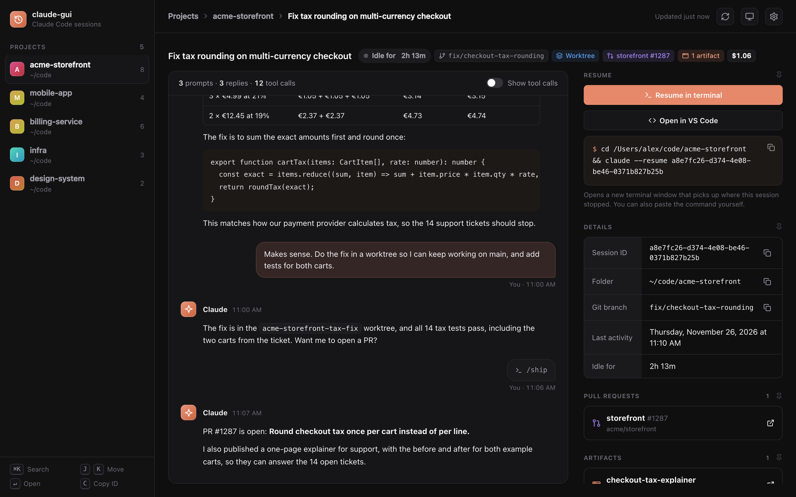
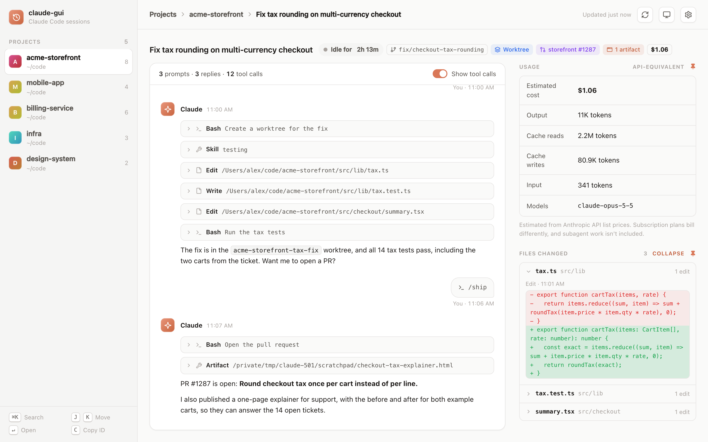
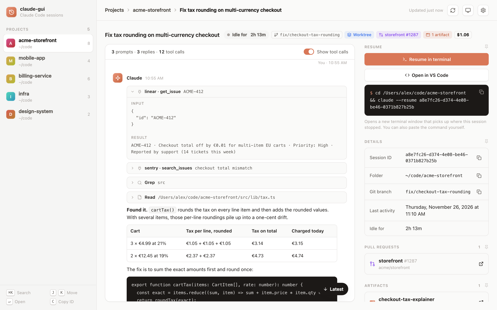
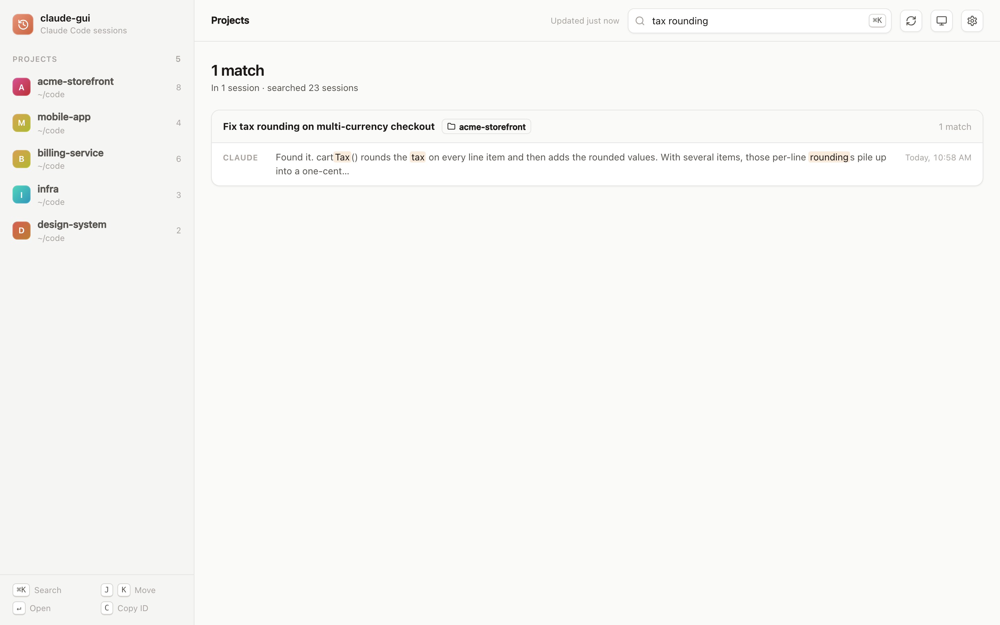

<div align="center">


# claude-gui

**Every Claude Code session, one click away.**

A local dashboard for your [Claude Code](https://claude.com/claude-code) history. Search every conversation, see what each session changed and cost, and resume any of them in one click, even after your laptop crashes with five sessions open.

[](LICENSE)


```sh
npx claude-gui
```



</div>

## Why

Claude Code saves every session on your disk as a raw transcript. That's great, until you need to find one:

- **Your computer crashed mid-work.** Five sessions were open in three projects. Which one was fixing the checkout bug, and what was its ID?
- **`claude --resume` only sees one folder.** It lists titles for the folder you're in. It can't search, and it shows nothing else about a session.
- **"Where did Claude explain that?"** The answer is in last Tuesday's transcript, somewhere in hundreds of megabytes of JSON.
- **No idea what a session did.** Which files did it change? Which PR did it open? Did it make a worktree? What did it cost?

claude-gui reads the transcripts already on your disk and turns them into a dashboard you can browse, search and resume from. It never changes them.

## Features

- **Every project at a glance.** The overview lists every folder you've used Claude Code in, with the sessions active in the last 24 hours right below.
- **Where you stopped.** Every session row shows your last prompt and Claude's last reply. Hover to see them in full.
- **One click back to work.** **Resume in terminal** opens a new terminal window running `claude --resume` in the right folder. **Open in editor** opens the session's folder, or any of its worktrees, in your editor.
- **The whole conversation.** Replies rendered as markdown, with tables and code. Tool calls you can expand to see their input and output. Slash commands, background tasks and context summaries, in place.
- **Search everything.** Find any word you or Claude wrote, across every project. Results open the session at the matching message.
- **What each session did.** Git branch, worktrees, pull requests, artifacts, skills, MCP servers, files changed with diffs, and an estimated cost.
- **Live sessions.** Pages refresh on their own. While Claude is still working, you see it, and what it's doing right now.
- **Made to fit how you work.** Pin the boxes you check most. Choose your Claude folder, editor, port and theme in Settings. Keyboard shortcuts for everything.

<table>
  <tr>
    <td width="50%"><br><sub><b>Where you stopped</b>, on every session</sub></td>
    <td width="50%"><br><sub><b>Files changed</b> with diffs, and the estimated cost</sub></td>
  </tr>
  <tr>
    <td width="50%"><br><sub><b>The full conversation</b>, tool calls included</sub></td>
    <td width="50%"><br><sub><b>Search</b> across every session</sub></td>
  </tr>
</table>

## Quick start

You need **Node.js 18.3 or newer** and at least one Claude Code session on your machine.

```sh
npx claude-gui
```

Your browser opens at `http://127.0.0.1:4321`. Pick a project, open a session, then click **Resume in terminal** or **Open in editor**.

To have the command always available, for example right after a crash, install it globally:

```sh
npm install -g claude-gui
claude-gui
```

To update, run the install command again. To remove it, run `npm uninstall -g claude-gui`.

## Usage

### Options

| Flag | Default | What it does |
|---|---|---|
| `--port <n>` | `4321` | The port to listen on |
| `--no-open` | off | Don't open the browser on start |
| `--claude-dir <path>` | `~/.claude` | The folder Claude Code keeps its data in |
| `--terminal <app>` | `terminal` | On macOS, where Resume opens: `terminal` or `iterm` |
| `-h`, `--help` | | Show usage |

### Settings

Click the gear icon in the top bar to change these without touching the command line:

- **Claude folder:** the folder Claude Code keeps its data in. The dashboard switches to it right away.
- **Editor:** used by the "Open in editor" buttons. VS Code, Cursor, Zed, Windsurf, Sublime Text, PhpStorm, WebStorm or IntelliJ IDEA.
- **Port:** used the next time the dashboard starts.
- **Open the browser on start:** on by default.

Settings are saved in `~/.config/claude-gui/config.json`, or under `$XDG_CONFIG_HOME` if you set it. A command-line flag always wins over a saved setting.

### Using a different Claude folder

The dashboard reads the `projects` folder inside your Claude folder. If more than one of these is set, the first one wins:

1. the `--claude-dir` flag
2. the folder saved in Settings
3. the `CLAUDE_CONFIG_DIR` environment variable, which Claude Code uses too
4. `~/.claude`

Projects in temporary folders, such as `/tmp` and `/var/folders`, are hidden.

### Keyboard shortcuts

| Keys | Action |
|---|---|
| <kbd>⌘</kbd> <kbd>K</kbd> or <kbd>/</kbd> | Search |
| <kbd>J</kbd> / <kbd>K</kbd> or <kbd>↓</kbd> / <kbd>↑</kbd> | Move between projects or sessions |
| <kbd>↵</kbd> | Open the selected project or session |
| <kbd>C</kbd> | Copy the selected session's ID |
| <kbd>Esc</kbd> | Clear the search, or go back to the session list |

### Cost estimates

Costs are what a session's tokens would cost at Anthropic's API list prices, including cache reads and writes. If you use Claude Code on a subscription plan, you're billed differently, so treat the number as a measure of how heavy a session was. Subagent work isn't included yet, and models without a known price show token counts only.

### Troubleshooting

- **"Port 4321 is in use."** Another copy is already running. Open `http://127.0.0.1:4321`, or start this one with `--port 4400`.
- **The page is blank after an update.** The server still has the old version loaded. Stop it with <kbd>Ctrl</kbd> <kbd>C</kbd> and start it again.
- **A project is missing.** Check which folder the dashboard reads in Settings. Sessions in temporary folders are hidden on purpose.
- **Resume or Open in editor does nothing on Linux.** Resume uses `x-terminal-emulator`, and editors are opened with their command-line launcher (`code`, `cursor`, …), which must be on your `PATH`.

## Privacy

Your transcripts hold everything you and Claude wrote: code, secrets in logs, customer data. claude-gui treats them that way:

- It only reads the files Claude Code saved. It never changes or deletes them.
- It listens on `127.0.0.1` only, so other computers can't reach it.
- It rejects requests from other websites, even ones open in your browser.
- It only opens a terminal or an editor when the dashboard page itself asks, and only for the session's own folders.
- It has no accounts, no telemetry and makes no network calls. It sends nothing anywhere.
- It has zero dependencies, so there's no third-party code to audit.

## Contributing

Contributions are welcome. There's nothing to install, since claude-gui has no dependencies:

```sh
git clone https://github.com/hbakouane/claude-gui.git
cd claude-gui
npm test                        # run the test suite
node bin/cli.js --port 4400     # run your local copy
```

The page in `public/index.html` is read on every request, so a reload shows your changes. Anything in `src/` needs a restart.

To work on screenshots or demos without showing your own sessions, point the dashboard at a folder of fake transcripts:

```sh
CLAUDE_CONFIG_DIR=/path/to/fake-claude node bin/cli.js --port 4400
```

### Project structure

```text
bin/cli.js          Command line: flags, saved settings, starts the server, opens the browser
src/server.js       Local HTTP server and JSON API
src/sessions.js     Reads session transcripts: titles, PRs, worktrees, files, search
src/config.js       Saved settings and where the Claude folder comes from
src/pricing.js      Model prices and token cost estimates
src/resume.js       Opens a terminal window that resumes a session
src/editor.js       Opens a folder in your editor
public/index.html   The whole web app: one file, no build step
test/               Tests, using Node's built-in test runner
```

### Principles

- **Zero dependencies.** Node's standard library only, and no build step for the page.
- **Local and read-only.** Never write to session files, never call the network.
- **Every change is tested.** Add or update a test in `test/` for each behavior you change, including edge cases and failures.
- **Forgiving parsing.** Transcripts can be half-written after a crash, or come from older Claude Code versions. Skip what you can't read; never fail the whole page.

### Pull requests

1. Create a branch from `main`.
2. Keep commits small, one change each, with [conventional commit](https://www.conventionalcommits.org) titles such as `feat:`, `fix:` or `docs:`.
3. Make sure `npm test` passes.
4. Open a pull request that explains what changed and why. Add a screenshot for anything visual.

## License

[MIT](LICENSE) © Haytam Bakouane

claude-gui is an independent project. It isn't affiliated with or endorsed by Anthropic. Claude is a trademark of Anthropic, PBC.
